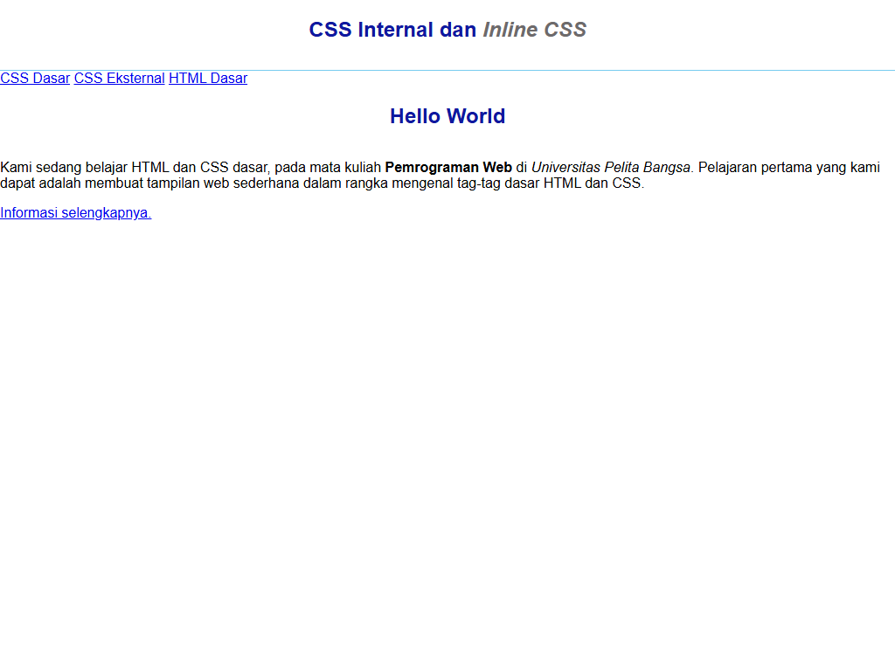
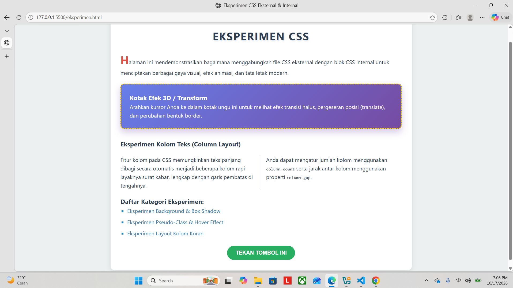

# Dokumentasi Praktikum Web: HTML Lanjutan

**Identitas Mahasiswa:**
- **Nama:** Gama Daya Laksana
- **NIM:** 312510051
- **Kelas:** I253A
- **Program Studi:** Teknik Informatika
- **Dosen Pengampu:** Agung Nugroho, S.Kom., M.Kom.
- **Kampus:** Universitas Pelita Bangsa

---
## Panduan Screenshot Tugas

Semua file tangkapan layar (*screenshot*) tersimpan rapi di dalam direktori `screenshots/` dengan format penamaan angka (`1.png` sampai `6.png`) sesuai urutan pengerjaan pada modul:

| No File | Aplikasi / Lokasi | Yang Harus Di-Screenshot / Ditampilkan |
|:---|:---|:---|
| **`1.png`** | Browser | **Langkah 1 (Gambar 2 Modul):** Tampilan awal dokumen HTML murni tanpa gaya CSS. Seluruh elemen tampil polos (*default browser style*). |
| **`2.png`** | Browser | **Langkah 2 (Gambar 3 Modul):** Penambahan Internal CSS pada tag `<head>` (font *Open Sans*, border bawah pada `<header>`, dan perataan judul `<h1>` ke tengah berwarna biru). |
| **`3.png`** | Browser | **Langkah 3 (Gambar 4 Modul):** Penambahan Inline CSS pada tag `<p>` di dalam `#intro` (teks paragraf rata tengah dengan warna `#ccd8e4`). |
| **`4.png`** | Browser | **Langkah 4 (Gambar 5 Modul):** Pembuatan dan penyisipan file eksternal `style_eksternal.css` untuk mempercantik bilah navigasi `<nav>` berwarna hijau `#20A759` beserta efek tautannya. |
| **`5.png`** | Browser | **Langkah 5 (Gambar 6 Modul):** Penambahan ID Selector (`#intro`) dan Class Selector (`.button`, `.btn-primary`) pada `style_eksternal.css` sehingga membentuk kotak intro biru bergaris hijau dan tombol aksi merah. |
| **`6.png`** | Browser (`eksperimen.html`) | **Tugas & Evaluasi Modul:** Halaman interaktif implementasi eksperimen CSS modern serta pengujian nyata atas pertanyaan spesifitas dan prioritas CSS. |

---

## Struktur Direktori Proyek

```text
Lab3Web/
├── screenshots/
│   ├── 1.png               
│   ├── 2.png               
│   ├── 3.png               
│   ├── 4.png              
│   ├── 5.png              
│   └── 6.png               
├── README.md                 
├── eksperimen.html
├── lab2_css_dasar.html         
└── style.css
└── style_eksternal.css       
```

---

## Langkah-langkah Praktikum

### 1. Membuat Dokumen HTML Dasar (`lab2_css_dasar.html`)
Langkah awal adalah membuat struktur dokumen HTML5 standar yang memuat elemen `<header>`, menu `<nav>`, dan kontainer `<div id="intro">` dengan tombol tautan:

```html
<!DOCTYPE html>
<html lang="en">
<head>
    <meta charset="UTF-8">
    <meta name="viewport" content="width=device-width, initial-scale=1.0">
    <title>CSS Dasar</title>
</head>
<body>
    <header>
        <h1>CSS Internal dan <i>Inline CSS</i></h1>
    </header>
    <nav>
        <a href="lab2_css_dasar.html">CSS Dasar</a>
        <a href="lab2_css_eksternal.html">CSS Eksternal</a>
        <a href="lab1_tag_dasar.html">HTML Dasar</a>
    </nav>
    <!-- CSS ID Selector -->
    <div id="intro">
        <h1>Hello World</h1>
        <p>Kami sedang belajar HTML dan CSS dasar, pada mata kuliah 
        <b>Pemrograman Web</b> di <i>Universitas Pelita Bangsa</i>. Pelajaran pertama 
        yang kami dapat adalah membuat tampilan web sederhana dalam rangka mengenal 
        tag-tag dasar HTML dan CSS.</p>
        <!-- CSS Class Selector -->
        <a class="button btn-primary" href="#intro">Informasi selengkapnya.</a>
    </div>
</body>
</html>
```

**Screenshot Hasil Langkah 1 (HTML Murni):**  


---

### 2. Mendeklarasikan Internal CSS
Menambahkan aturan CSS di dalam tag `<style>` pada bagian `<head>` dokumen untuk mengatur tipografi body, border header, dan perataan judul:

```html
<style>
    body {
        font-family: 'Open Sans', sans-serif;
    }
    header {
        min-height: 80px;
        border-bottom: 1px solid #77CCEF;
    }
    h1 {
        font-size: 24px;
        color: #0F189F;
        text-align: center;
        padding: 20px 10px;
    }
    h1 i {
        color: #6d6a6b;
    }
</style>
```

**Screenshot Hasil Langkah 2 (Internal CSS):**  


---

### 3. Menambahkan Inline CSS
Menyisipkan atribut `style` langsung pada tag `<p>` di dalam elemen `<div id="intro">`:

```html
<p style="text-align: center; color: #ccd8e4;">
    Kami sedang belajar HTML dan CSS dasar, pada mata kuliah ...
</p>
```

**Screenshot Hasil Langkah 3 (Inline CSS):**  


---

### 4. Membuat dan Mengintegrasikan CSS Eksternal (`style_eksternal.css`)
Membuat file terpisah bernama `style_eksternal.css` untuk mendeklarasikan penataan bilah navigasi:

```css
nav {
    background: #20A759;
    color: #fff;
    padding: 10px;
}
nav a {
    color: #fff;
    text-decoration: none;
    padding: 10px 20px;
}
nav .active, 
nav a:hover {
    background: #0B6B3A;
}
```

Kemudian dihubungkan pada bagian `<head>` berkas HTML menggunakan tag `<link>`:
```html
<link rel="stylesheet" href="style_eksternal.css" type="text/css">
```

**Screenshot Hasil Langkah 4 (Eksternal CSS):**  


---

### 5. Menambahkan CSS Selector (ID dan Class Selector)
Melengkapi file `style_eksternal.css` dengan aturan ID Selector (`#intro`) dan Class Selector (`.button`, `.btn-primary`):

```css
/* ID Selector */
#intro {
    background: #418fb1;
    border: 1px solid #099249;
    min-height: 100px;
    padding: 10px;
}
#intro h1 {
    text-align: left;
    border: 0;
    color: #fff;
}

/* Class Selector */
.button {
    padding: 15px 20px;
    background: #bebcbd;
    color: #fff;
    display: inline-block;
    margin: 10px;
    text-decoration: none;
}
.btn-primary {
    background: #E42A42;
}
```

**Screenshot Hasil Langkah 5 (ID & Class Selector Lengkap):**  


###  6. Eksperimen HTML Dan Jawaban Tugas

```HTML

<!DOCTYPE html>
<html lang="id">
<head>
    <meta charset="UTF-8">
    <meta name="viewport" content="width=device-width, initial-scale=1.0">
    <title>Eksperimen CSS Eksternal & Internal</title>
    
    <!-- MEMANGGIL CSS EKSTERNAL -->
    <link rel="stylesheet" href="style.css">

    <!-- EKSPERIMEN CSS INTERNAL -->
    <style>
        /* Mengatur Box Model & Background dengan Linear Gradient */
        .experiment-box {
            background: linear-gradient(135deg, #667eea 0%, #764ba2 100%);
            color: #ffffff;
            padding: 25px;
            margin: 20px 0;
            border-radius: 10px;
            border: 3px dashed #ffd700;
            box-shadow: 0 10px 20px rgba(118, 75, 162, 0.3);
            transition: all 0.4s ease-in-out;
        }

        /* Eksperimen Pseudo-Class (:hover) dan 2D Transform */
        .experiment-box:hover {
            transform: translateY(-8px) scale(1.02);
            box-shadow: 0 15px 30px rgba(118, 75, 162, 0.5);
            border-style: solid;
        }

        /* Eksperimen Multiple Columns */
        .column-layout {
            column-count: 2;
            column-gap: 30px;
            column-rule: 2px solid #bdc3c7;
            margin: 20px 0;
        }

        /* Eksperimen Styling List & Markers */
        .styled-list {
            list-style-type: square;
            margin-left: 20px;
        }

        .styled-list li {
            margin-bottom: 8px;
            color: #2980b9;
        }

        /* Eksperimen Button dengan UI & Cursor Kustom */
        .btn-experiment {
            display: inline-block;
            background-color: #27ae60;
            color: white;
            padding: 12px 25px;
            border: none;
            border-radius: 25px;
            font-size: 16px;
            font-weight: bold;
            cursor: pointer;
            outline: none;
            transition: background-color 0.3s, transform 0.2s;
            text-transform: uppercase;
        }

        /* Pseudo-Class :active saat tombol diklik */
        .btn-experiment:active {
            transform: scale(0.95);
            background-color: #219653;
        }

        /* Pseudo-Element ::first-letter & ::before */
        p.highlight-text::first-letter {
            font-size: 200%;
            font-weight: bold;
            color: #e74c3c;
        }
    </style>
</head>
<body>

    <div class="container">
        <h1>Eksperimen CSS</h1>
        <p class="highlight-text">Halaman ini mendemonstrasikan bagaimana menggabungkan file CSS eksternal dengan blok CSS internal untuk menciptakan berbagai gaya visual, efek animasi, dan tata letak modern.</p>

        <!-- Kotak Eksperimen 1: Gradient, Border, & Transform -->
        <div class="experiment-box">
            <h3>Kotak Efek 3D / Transform</h3>
            <p>Arahkan kursor Anda ke dalam kotak ungu ini untuk melihat efek transisi halus, pergeseran posisi (translate), dan perubahan bentuk border.</p>
        </div>

        <!-- Kotak Eksperimen 2: Multi-Column Layout -->
        <div style="margin-top: 30px;">
            <h3>Eksperimen Kolom Teks (Column Layout)</h3>
            <div class="column-layout">
                <p>Fitur kolom pada CSS memungkinkan teks panjang dibagi secara otomatis menjadi beberapa kolom rapi layaknya surat kabar, lengkap dengan garis pembatas di tengahnya.</p>
                <p>Anda dapat mengatur jumlah kolom menggunakan <code>column-count</code> serta jarak antar kolom menggunakan properti <code>column-gap</code>.</p>
            </div>
        </div>

        <!-- Kotak Eksperimen 3: List & Interactive Button -->
        <div style="margin-top: 20px;">
            <h3>Daftar Kategori Eksperimen:</h3>
            <ul class="styled-list">
                <li>Eksperimen Background & Box Shadow</li>
                <li>Eksperimen Pseudo-Class & Hover Effect</li>
                <li>Eksperimen Layout Kolom Koran</li>
            </ul>

            <div style="text-align: center; margin-top: 25px;">
                <button class="btn-experiment">Tekan Tombol Ini</button>
            </div>
        </div>
    </div>

</body>
</html>

```

```CSS
/* ==========================================
   1. EKSPERIMEN CSS EKSTERNAL (style.css)
   ================================---------- */

/* Variabel Global & Root */
:root {
    --primary-color: #3498db;
    --secondary-color: #2ecc71;
    --dark-color: #2c3e50;
    --light-bg: #ecf0f1;
}

/* Universal Selector */
* {
    box-sizing: border-box;
    margin: 0;
    padding: 0;
}

/* Type Selector & Body */
body {
    font-family: 'Segoe UI', Tahoma, Geneva, Verdana, sans-serif;
    background-color: var(--light-bg);
    color: var(--dark-color);
    line-height: 1.6;
    padding: 20px;
}

/* Layout Utama & Container */
.container {
    max-width: 900px;
    margin: 0 auto;
    background: #ffffff;
    padding: 30px;
    border-radius: 12px;
    box-shadow: 0 5px 15px rgba(0, 0, 0, 0.1);
}

/* Typography & Text Experiment */
h1 {
    text-align: center;
    color: var(--dark-color);
    margin-bottom: 20px;
    text-transform: uppercase;
    letter-spacing: 2px;
    text-shadow: 2px 2px 4px rgba(0, 0, 0, 0.1);
}
```

**Screenshot Hasil Halaman Eksperimen & Pembuktian Soal:**  


#### 1. Lakukan eksperimen dengan mengubah dan menambah properti dan nilai pada kode CSS dengan mengacu pada CSS Cheat Sheet!

---

### **1. Variabel Global (`:root`)**

Bagian ini berfungsi sebagai pusat penyimpanan nilai (seperti kode warna) yang bisa digunakan kembali di seluruh file CSS.

* **`--primary-color`**: Warna biru (`#3498db`) untuk elemen utama atau tautan.
* **--secondary-color**: Warna hijau (`#2ecc71`) untuk tombol atau penanda sukses.
* **`--dark-color`**: Warna abu-abu gelap/biru tua (`#2c3e50`) untuk teks standar.
* **`--light-bg`**: Warna latar belakang halaman (`#ecf0f1`).

---

### **2. Selector Universal & Dasar (`*` & `body`)**

* **`*` (Universal Selector)**:
* `box-sizing: border-box`: Memastikan ukuran elemen (lebar dan tinggi) sudah termasuk *padding* dan *border*, sehingga tata letak tidak mudah berantakan.
* `margin: 0; padding: 0`: Menghapus jarak bawaan (*default*) dari browser pada semua elemen.


* **`body`**:
* Mengatur jenis huruf standar (`font-family`), warna latar belakang menggunakan variabel, serta memberikan jarak luar (*padding*) agar konten tidak menempel di tepi layar.


---

### **3. Layout Utama & Tipografi (`.container` & `h1`)**

* **`.container`**:
* Berfungsi sebagai pembungkus utama konten dengan lebar maksimum 900 piksel.
* `margin: 0 auto`: Membuat kotak pembungkus ini selalu berada di tengah layar secara otomatis.
* Dilengkapi sudut melengkung (`border-radius: 12px`) dan efek bayangan lembut (`box-shadow`) agar tampak seperti kartu yang elegan.


* **`h1`**:
* Mengatur judul agar berada di tengah (`text-align: center`), huruf kapital semua (`text-transform: uppercase`), jarak antar huruf yang renggang (`letter-spacing`), serta bayangan teks tipis.


---

### **4. Kotak Efek Visual & Animasi (`.experiment-box` & `:hover`)**

* **`.experiment-box`**:
* `background: linear-gradient(...)`: Membuat latar belakang gradien warna ungu.
* `border: 3px dashed #ffd700`: Memberikan garis tepi putus-putus berwarna kuning keemasan.
* `transition: all 0.4s ease-in-out`: Mengatur durasi perubahan agar animasi berjalan sangat mulus selama 0,4 detik.


* **`.experiment-box:hover` (Saat kursor mendekat)**:
* `transform: translateY(-8px) scale(1.02)`: Menggeser kotak ke atas sejauh 8 piksel dan memperbesarnya sedikit (efek 3D/melayang).
* `border-style: solid`: Mengubah garis tepi yang tadinya putus-putus menjadi garis utuh.


---

### **5. Tata Letak Kolom Koran (`.column-layout`)**

* **`column-count: 2`**: Membagi teks di dalam elemen ini secara otomatis menjadi dua kolom sejajar layaknya koran.
* **`column-gap: 30px`**: Memberikan jarak kosong seluas 30 piksel di antara kolom kiri dan kanan.
* **`column-rule: 2px solid #bdc3c7`**: Menambahkan garis pembatas vertikal tipis di tengah kedua kolom tersebut.

---

### **6. Styling Daftar (`.styled-list`)**

* **`list-style-type: square`**: Mengubah bentuk titik daftar (*bullet point*) standar menjadi bentuk kotak kecil.
* Mengatur warna teks pada setiap item daftar (`<li>`) menggunakan variabel warna utama.

---

### **7. Tombol Interaktif (`.btn-experiment` & `:active`)**

* **`.btn-experiment`**:
* Membuat tombol berbentuk lonjong melengkung (`border-radius: 25px`) dengan warna latar hijau dan kursor berubah menjadi ikon tangan (`cursor: pointer`).


* **`.btn-experiment:active` (Saat tombol ditekan)**:
* `transform: scale(0.95)`: Membuat ukuran tombol sedikit menciut saat diklik untuk memberikan efek responsif fisik yang nyata.


---

### **8. Pseudo-Element Huruf Besar (`::first-letter`)**

* **`p.highlight-text::first-letter`**:
* Menargetkan secara spesifik huruf pertama pada paragraf tertentu untuk dibuat jauh lebih besar (`font-size: 200%`) dan diberi warna merah, menciptakan gaya penulisan majalah (*drop cap*).

### Jawaban Pertanyaan dan Tugas

#### 2. Apa perbedaan pendeklarasian CSS elemen `h1 {...}` dengan `#intro h1 {...}`? Berikan penjelasannya!
**Penjelasan Teknis:**
- **`h1 {...}` (Type / Element Selector):**  
  Aturan ini bersifat **global**. Artinya, seluruh elemen `<h1>` yang berada di bagian mana pun pada dokumen HTML tersebut akan terkena aturan style ini (misalnya warna biru dan rata tengah). Nilai spesifitasnya adalah `(0, 0, 0, 1)`.
- **`#intro h1 {...}` (Descendant Selector):**  
  Aturan ini bersifat **lokal dan spesifik**. Artinya, aturan ini **hanya berlaku** untuk elemen `<h1>` yang berada di dalam kontainer yang memiliki ID `intro` (`<div id="intro"><h1>...</h1></div>`). Elemen `<h1>` di luar ID `intro` tidak akan terpengaruh. Nilai spesifitasnya jauh lebih tinggi, yaitu `(0, 1, 0, 1)` (memiliki 1 ID dan 1 Element), sehingga mampu menimpa (*override*) aturan `h1` global.

**Contoh Pembuktian:**
Pada praktikum, `h1` di header tetap berwarna biru dan rata tengah, sedangkan `h1` di dalam `#intro` berubah menjadi rata kiri dan berwarna putih karena aturan `#intro h1` lebih spesifik.

---

#### 3. Apabila ada deklarasi CSS secara internal, lalu ditambahkan CSS eksternal dan inline CSS pada elemen yang sama. Deklarasi manakah yang akan ditampilkan pada browser? Berikan penjelasan dan contohnya!
**Penjelasan Teknis:**  
Deklarasi yang akan ditampilkan pada browser adalah **Inline CSS** (aturan yang ditulis langsung pada atribut `style=""` elemen HTML).

**Alasan / Hierarki Cascading (*CSS Specificity Rule*):**
1. **Inline CSS** memiliki bobot spesifitas tertinggi yaitu `(1, 0, 0, 0)`.
2. **Internal CSS** dan **External CSS** berada pada tingkatan spesifitas yang sama (tergantung selector yang digunakan, misalnya class `(0, 0, 1, 0)` atau tag `(0, 0, 0, 1)`). Jika bobot selector keduanya identik, aturan yang berada **paling akhir dibaca oleh browser** (*last declaration order*) yang akan menang.
3. Selama tidak ada penanda `!important` pada stylesheet, Inline CSS akan selalu mengalahkan (*override*) deklarasi Internal maupun Eksternal CSS.

**Contoh Pembuktian:**
```html
<!-- CSS Eksternal / Internal -->
<style>
    .pesan { color: blue; font-size: 16px; }
</style>

<!-- Elemen dengan Inline CSS -->
<p class="pesan" style="color: red;">
    Teks ini akan tampil berwarna MERAH di browser karena Inline CSS mengalahkan Internal CSS.
</p>
```

---

#### 4. Pada sebuah elemen HTML terdapat ID dan Class, apabila masing-masing selector tersebut terdapat deklarasi CSS, maka deklarasi manakah yang akan ditampilkan pada browser? Berikan penjelasan dan contohnya! (`<p id="paragraf-1" class="text-paragraf">`)
**Penjelasan Teknis:**  
Deklarasi yang akan ditampilkan untuk properti yang saling berbenturan (misalnya `color`) adalah **deklarasi dari ID Selector (`#paragraf-1`)**.

**Alasan / Aturan Bobot Spesifitas:**
- Bobot spesifitas **ID Selector** adalah `(0, 1, 0, 0)` (setara nilai 100).
- Bobot spesifitas **Class Selector** adalah `(0, 0, 1, 0)` (setara nilai 10).
- Karena `100 > 10`, maka deklarasi pada `#paragraf-1` memiliki prioritas yang jauh lebih kuat dibandingkan `.text-paragraf`.

**Catatan Mengenai Sifat *Cascading*:**  
Hanya properti yang berbenturan yang dimenangkan oleh ID. Properti lain yang tidak berbenturan dari Class Selector tetap akan diterapkan pada elemen tersebut (*merge/inherit*).

**Contoh Pembuktian:**
```css
#paragraf-1 {
    color: red;           /* Menang melawan green */
    font-weight: bold;
}

.text-paragraf {
    color: green;         /* Kalah spesifitas */
    font-style: italic;   /* Tetap diterapkan karena tidak bentrok */
}
```
Hasil pada browser: Teks akan berwarna **MERAH** (dari ID), berbobot **tebal** (dari ID), dan bergaya **miring** (dari Class).

---


---

## Checklist Sebelum Dikumpulkan

Berdasarkan checklist pada modul praktikum:
- [x] Tabel berhasil ditampilkan dan memiliki header yang sesuai.
- [x] Form memiliki label dan beberapa jenis input.
- [x] Radio button dan checkbox sudah digunakan.
- [x] Select dan textarea sudah digunakan.
- [x] Validasi required dan validasi dasar lainnya sudah dicoba.
- [x] Semantic HTML sudah digunakan.
- [x] Audio dan/atau video berhasil ditampilkan.
- [x] Proyek mini biodata menggabungkan materi utama.
- [x] Screenshot dan README.md sudah tersedia.
- [x] Repository sudah di-commit dan URL siap dikirim.
